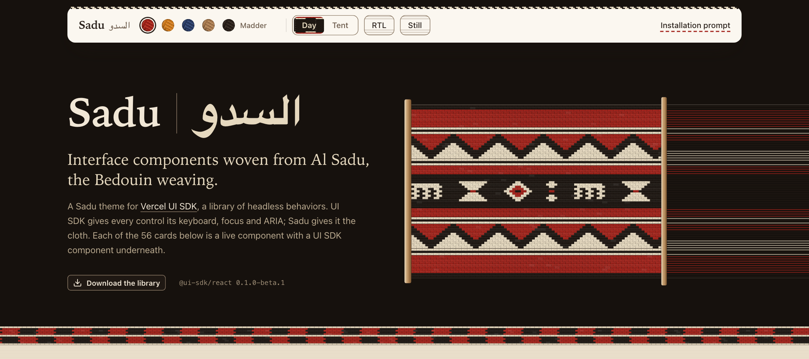
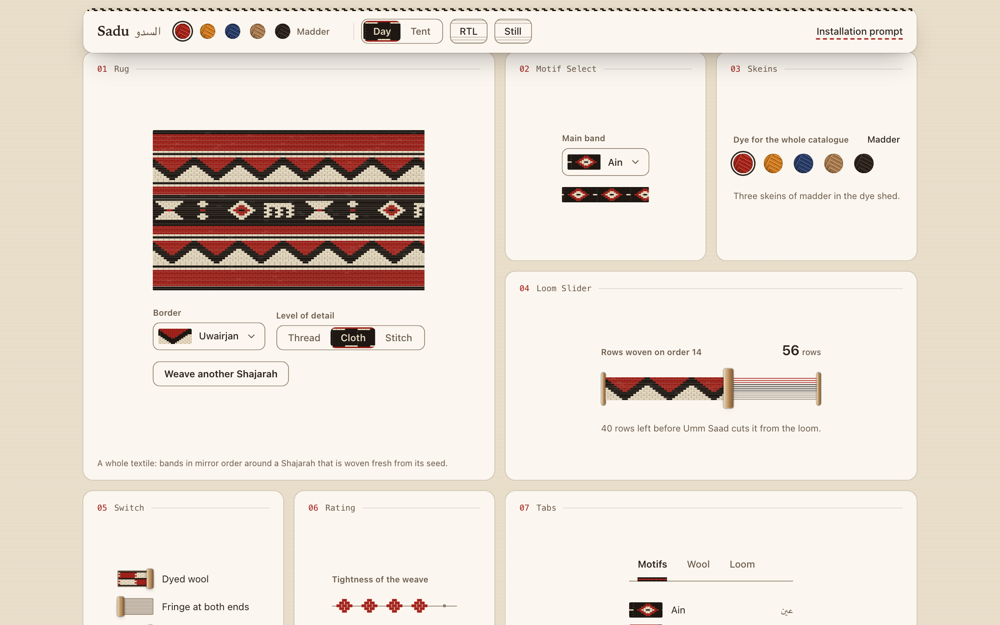
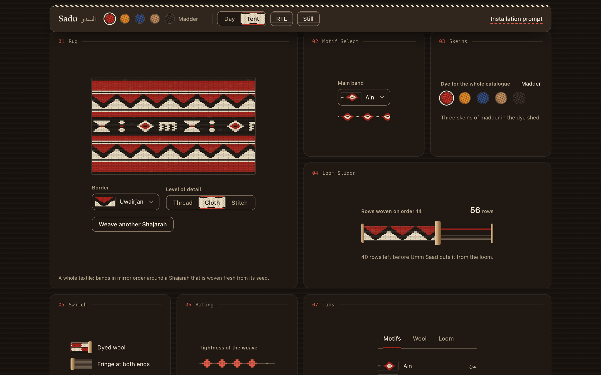
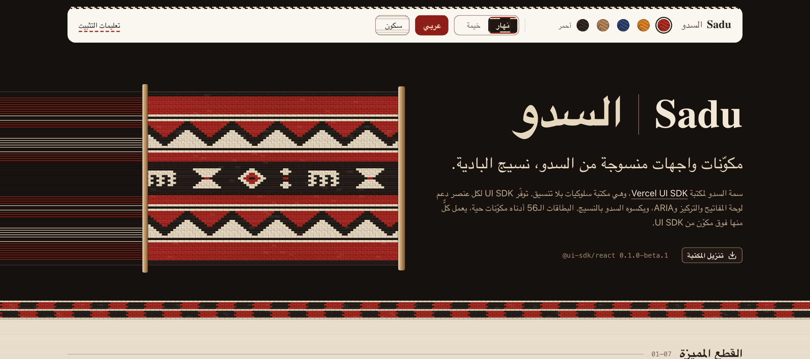
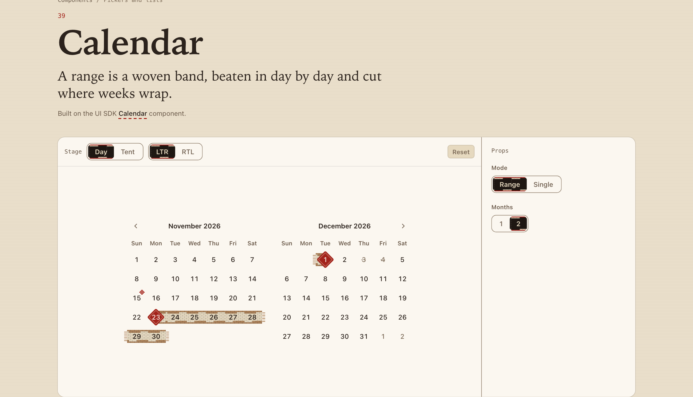

# Sadu السدو

React components styled after Al Sadu, the Bedouin weaving, and built on [Vercel UI SDK](https://ui-sdk.dev). UI SDK handles keyboard, focus and ARIA. Sadu draws every control as woven cloth, with a wood beater, warp threads and eye marks.

Live catalogue: **[sadu-ui.pages.dev](https://sadu-ui.pages.dev)**



All 56 components are live on the site. Each one has a page with a props playground, its states, its keyboard map, the source, and a zip download.



## Install a component

Components install through the shadcn registry. Each item brings the shared foundation (`sadu-core`) and any items it depends on.

```sh
npx shadcn@latest add https://sadu-ui.pages.dev/r/sadu-switch.json
```

The site lists every item, and `https://sadu-ui.pages.dev/r/registry.json` has the full index. Files land in `components/sadu/`. You need React 19 and `@ui-sdk/react`, which shadcn adds for you.

Import the stylesheet once, then use the component:

```tsx
import "@/components/sadu/sadu.css"
import { SaduSwitch } from "@/components/sadu/sadu-switch"

export function Settings() {
  return <SaduSwitch defaultChecked>Dyed wool</SaduSwitch>
}
```

Set `data-theme="day"` or `data-theme="tent"` on the root element. Add `dir="rtl"` and `lang="ar"` to pages that read right to left; the components switch their built-in labels to Arabic from `lang`.

To use the components with a coding agent, open the site and copy the "Installation prompt" from the top bar.

## Themes and Arabic

Day is wool in daylight. Tent is the goat-hair tent at night. Every component also works right to left, with Arabic copy.

| Tent theme | Arabic, right to left |
| --- | --- |
|  |  |



## Work on the repo

```sh
npm install
npm run dev        # http://localhost:5191
npm test           # unit tests (Vitest)
npm run test:e2e   # browser tests (Playwright, local Chrome)
npm run build
```

- `src/sadu/` holds the components. Each one is `<name>.tsx` with styles in `styles/<name>.css`. The weave renderer, motifs, palette and shared parts sit beside them, and the tokens are in `sadu.css`.
- `src/gallery/` holds the demo for every component. The site reads its cards and captions from these files, so a demo change shows up on the site too.
- `src/site/` is the catalogue site.
- `scripts/build-registry.mjs` writes the shadcn registry to `public/r/` before every dev and build run.
- `docs/design/` has the design rules (`DESIGN.md`), the Arabic glossary (`ARABIC.md`), the design direction and the design review.

`npm run deploy` builds the site and publishes it to Cloudflare Pages. It runs only for the owner's Cloudflare account; see `scripts/deploy.sh`.

## Sources

The motifs and vocabulary come from the Al Sadu Society and Sadu House in Kuwait, UNESCO's listing of Al Sadu weaving, and the work of Crichton and Canavan. The motif grids are drawn from published descriptions, not copied from pieces. The Arabic copy still needs review by a native Kuwaiti reader.
